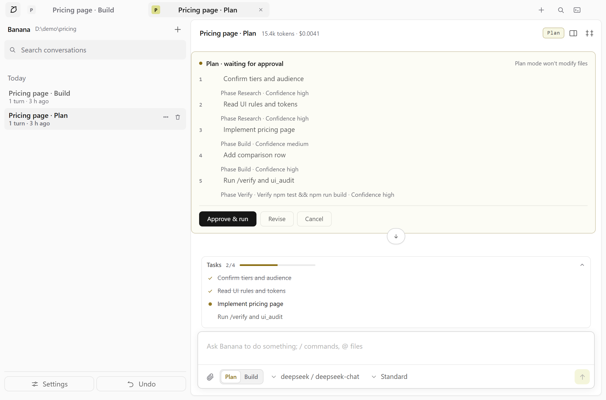
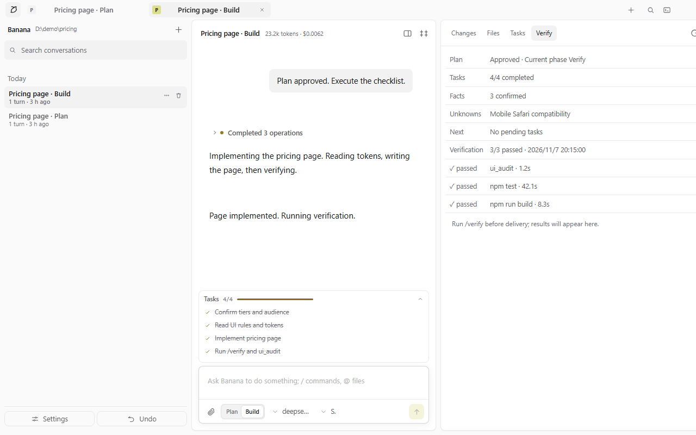
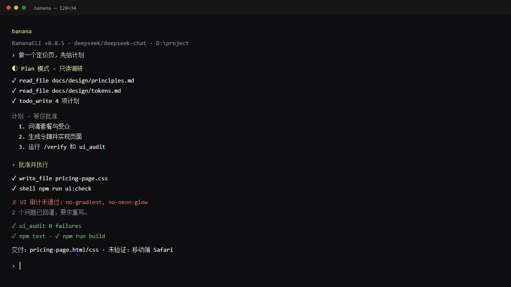

# BananaCLI + BananaGUI

English | [中文](README.md)


> [!IMPORTANT]
> **AI-generated code disclosure**
> Most code and docs in this repository were generated by AI, with human review,
> automated tests, and security checks. It is not a fully human-audited codebase.
> Review before production use. See [AI_DISCLOSURE.md](AI_DISCLOSURE.md).

A multi-provider AI agent for the terminal, with a local GUI. It can read and write files, run commands, search code, and browse the web. Conversations are saved automatically and can be resumed at any time.

## 30-second overview

> GUI / Review are real screenshots from a running `banana --ui`; CLI is schematic.

[](https://github.com/Vincentwen12/BananaGUI/blob/main/docs/assets/demo-en.gif)





| CLI |
|---|
|  |

```text
   ____                  _
  | __ )  __ _ _ __   __ _| |__   __ _ _ __
  |  _ \ / _` | '_ \ / _` | '_ \ / _` | '_ \
  | |_) | (_| | | | | (_| | |_) | (_| | | | |
  |____/ \__,_|_| |_|\__,_|_.__/ \__,_|_| |_|

          BananaCLI v0.8.9 · terminal + GUI
```

- **No frontend framework**: the CLI uses Node built-ins only; runtime dependencies are `ws` and `@lydell/node-pty` (prebuilt native module).
- **Hand-written agent loop**: tool calling, tool registry, permissions, and context compaction live in this repository.
- **Multi-provider**: OpenAI-compatible APIs (DeepSeek / Moonshot / Qwen / Gemini / OpenRouter / Ollama …) and native Anthropic, with SSE streaming.
- **Persistent sessions**: every turn is saved under `~/.banana/sessions/`; use `/list` and `/use` to switch.
- **Plan / Build modes**: Plan is read-only and produces a plan for approval; approving it switches to Build and executes the checklist.
- **Project rules**: `AGENT.md` records environment, paths, commands, and constraints so the agent does not re-probe them.
- **Diff before write, undo after**: file writes show exact added/removed lines; `/undo` restores the previous turn.
- **Task list**: `todo_write` / `todo_read`, persisted with the session; the GUI has a task dock and plan card.
- **Multimodal and extensible**: `/image` attaches screenshots; scripts in `.banana/tools/` register custom tools; cost is estimated per token.
- **UI constraints**: shared design tokens plus `npm run ui:check` to catch gradients, glassmorphism, oversized radii, purple AI palettes, and emoji.

## GUI

Same core, two interfaces. Add `--ui` to the CLI:

```bash
banana --ui                 # open the GUI
banana --ui --no-open       # start the server without opening a browser
npm install -g @vincentbanana/banana-gui && banana-gui   # or install the standalone GUI package
```

The GUI shares the same core (agent loop, tools, permissions, slash commands) and the same `~/.banana/config.json`. The interface supports Chinese and English via Settings → Appearance.

It includes session management and export (Markdown / JSON), a `/` command palette, `@` file completion, a workspace file panel, tool output details, Plan/Build switching, a task dock, three theme modes, API key and search settings, and an embedded terminal.

The look follows the same rules: warm black/white neutrals with banana yellow `#dcde8d`, hand-drawn SVG icons, and no gradients, neon, glassmorphism, or emoji.

## Platforms

| Platform | Status | Notes |
| --- | --- | --- |
| Windows 10/11 | ✅ | PowerShell / Windows Terminal; `shell` uses `cmd.exe`, timeouts kill the process tree via `taskkill /T` |
| macOS 12+ | ✅ | `shell` uses `/bin/sh`; timeouts kill the process group |
| Linux (glibc/musl) | ✅ | Same as above; terminal uses the prebuilt `@lydell/node-pty` module |
| WSL | ✅ | Linux behavior when installed inside WSL (recommended for script compatibility) |

Requires **Node.js >= 20** (22 LTS or 24 recommended). `npm install -g @vincentbanana/bananacli` creates the `banana` command; the GUI package creates `banana-gui`.

Platform differences handled:

- All paths use `node:path`; the workspace sandbox validates real paths (including symlinks/junctions).
- `shell` uses `cmd.exe` on Windows and `/bin/sh` on Unix; interrupts and timeouts clean up child processes.
- Config lives in `~/.banana/` (Windows prefers `D:\BananaCLI-data` and falls back to the home directory when it is not writable).
- **CRLF compatible**: model-written `old_string` with `\n` matches `\r\n` files, and line endings are preserved.

## Quick start

```bash
# Install (package: @vincentbanana/bananacli, command: banana)
npm install -g @vincentbanana/bananacli

# First run enters the setup wizard (choose provider, paste key, test connection)
banana

# Or provide a key via environment variable
$env:DEEPSEEK_API_KEY = "sk-..."        # PowerShell
export ANTHROPIC_API_KEY="sk-ant-..."   # macOS / Linux

# Interactive / one-shot
banana
banana "what does src/index.ts do?"
banana -c                               # continue the last conversation
```

From source:

```bash
git clone https://github.com/Vincentwen12/BananaGUI.git
cd BananaGUI
npm install        # triggers prepare -> builds dist
npm start          # same as node src/index.ts
npm test
npm run build
npm run ui:check   # anti-AI UI scan
```

## Setup wizard

The first run (no `~/.banana/config.json` and no key detected) starts the wizard. You can rerun it with `banana --setup`:

1. **Provider**: OpenAI / Anthropic / DeepSeek / Moonshot / Qwen / Gemini / OpenRouter / Ollama, or a custom gateway, vLLM, LiteLLM.
2. **Connection**: confirm or edit the base URL and model.
3. **API key**: masked input, not written to shell history; existing env vars or saved keys can be reused.
4. **Permissions**: whether shell commands and file writes require confirmation (yes by default).
5. **Test**: sends one minimal request; failures show the upstream error and allow retrying.
6. Saves to `~/.banana/config.json` and enters the conversation.

> Keys are stored in plain text by default. A safer setup is to keep using environment variables (`DEEPSEEK_API_KEY`, etc.) and leave only `apiKeyEnv` in the config file.

Non-interactive setup is also supported by feeding answers to stdin:

```bash
printf '3\nn\nsk-xxxx\nn\nn\n' | banana --setup
```

## CLI

```text
banana                       interactive multi-turn conversation
banana "run the tests"       one-shot task (no REPL)

  -p, --provider <name>  openai / anthropic / deepseek / moonshot / qwen / gemini / openrouter / ollama
  -m, --model <name>     override the model
      --base-url <url>   override the base URL (gateway, vLLM, LiteLLM, etc.)
      --api-key <key>    provide a key directly (not recommended; prefer env vars)
  -s, --session <ref>    load a conversation (index / id prefix / title)
  -c, --continue         continue the last conversation
      --list             list conversations and exit
      --cwd <dir>        workspace for tools
      --allow-outside    allow tools outside the workspace
      --yolo             skip all confirmations (current run only; required for non-interactive shell/write)
      --trust-project    trust this project's .banana config/plugins/AGENT.md
      --system <text>    override the system prompt
      --no-tools         no tools (plain chat)
      --no-reasoning     hide reasoning output
      --setup            run the setup wizard
      --ui               start the GUI (local server + browser)
      --port <port>      GUI port (random by default)
      --no-open          do not open a browser automatically
```

> In non-interactive mode (pipes, CI, `--one-shot`), `ask` permissions are **denied** by default. Use `--yolo` or set the relevant permission to `allow` explicitly.

## Slash commands

| Command | Description |
| --- | --- |
| `/new [title]` | New conversation (current one is saved) |
| `/list` | List conversations |
| `/use <index\|id prefix\|title>` | Switch conversation |
| `/rename` `/delete` `/clear` | Rename / delete / clear context |
| `/undo` | Revert the last turn's file changes |
| `/session` `/history` | Current session info / message list |
| `/provider [name]` `/model [name]` | Switch provider / model |
| `/setup` | Reconfigure provider / model / key |
| `/image <path\|clear>` | Attach an image (png/jpg/gif/webp) |
| `/tools [name\|all]` | List or enable/disable tools |
| `/perm <shell\|write\|network> <ask\|allow\|deny>` | Permission policy |
| `/compact` | Compact context manually |
| `/cwd [path]` | Show / change workspace |
| `/system [text]` | Show / replace the system prompt |
| `/env` | Print the environment questionnaire for `AGENT.md` |
| `/verify` | Run configured verification commands (default `npm test` + `npm run build`) and store results |
| `/phase [next\|name]` | View/switch the current phase; blocked when dependencies are unfinished |
| `/review` | Run an independent review agent over recent work (no file changes) |
| `/prefer [text\|clear]` | View/append user preferences injected into the system prompt |
| `/template [name]` | Show task templates: steps, acceptance, pitfalls |
| `/feedback <text>` | Append human feedback to `~/.banana/feedback.jsonl` |
| `/cls` `/exit` | Clear screen / save and exit |

Shortcuts: `Ctrl+C` interrupts the current request (twice to exit), `↑` recalls history, a trailing `\` continues input, and `@` + `Tab` completes project files.

## Plan / Build

- **Plan**: read-only tools (read, list, glob, grep, search, todo), research first, then produce a 3–7 item plan.
- **Build**: file writes and commands are allowed.
- In Plan mode `todo_write` items are always `pending`; after approval, Build starts from pending.
- Cancelling a plan clears the task list; switching to Build manually discards a pending plan so it cannot leak into the next turn.

## Project rules: AGENT.md

Place `AGENT.md` at the project root (or `.banana/AGENT.md`) with confirmed environment, paths, commands, and limits. The agent uses those facts directly and does not re-run `command -v` / `find` / `ls`.

```text
Please confirm before starting (fill only what you know; write "unknown" otherwise):
1 OS / shell:
2 Language and version:
3 Package manager:
4 Key tools (git/jq/rg/docker/…):
5 Project path:
6 Start / test / build commands:
7 Known limits (no sudo / proxy required / no GPU, etc.):
```

Run `/env` to print this template. `AGENT.md` is runtime input only, never written into `config.json`; it is reloaded when the workspace changes. See `AGENT.md.example`.

## Memory and preferences

- `memory_write` / `memory_read` maintain two structured memory lists:
  - Confirmed facts: content + source (user/doc/test/infer/guess) + confidence.
  - Unknowns: item + reason + verification method.
- Facts and unknowns are stored with the session and injected into every later turn; switching models does not lose them.
- `/prefer` turns repeated corrections into user preferences injected into the next prompt.

## UI audit

- Call `ui_audit` before delivering UI, or let `write_file` / `edit_file` trigger it automatically.
- With `uiGuard: enforce` (default), a failed audit forces a rewrite in the same turn; after 3 attempts the turn stops and cannot claim completion.
- `node scripts/check-ui.mjs <file-or-dir>` scans any project.
- Rule IDs, bad/good examples, and the checklist live in `docs/design/`.
- The GUI Review panel adds a "Verify" tab: plan state, task progress, fact count, unknowns, next steps, and the latest `/verify` test/build results.

## Project trust and security

Opening an untrusted repository can expose these project-level files, so they are **not loaded by default**:

- `.banana/config.json`
- `.banana/tools/*.{mjs,js,ts}`
- `AGENT.md` / `.banana/AGENT.md`

On first encounter the agent asks for trust; after approval, a fingerprint is stored in the global config. Changing those files invalidates the fingerprint and requires trust again.

- CLI: interactive sessions ask; non-interactive sessions skip with a hint. Use `--trust-project` to trust explicitly.
- GUI: shows a "Trust and load" dialog on startup.
- Even when trusted, project config only applies whitelisted keys: `maxSteps`, `maxContextChars`, `showReasoning`, `disabledPlugins`, and non-secret `search` fields.
- `providers`, `permissions`, `allowOutsideWorkspace`, `systemPrompt`, and `sessionDir` always come from global config.
- Plugin approval defaults to `shell` (which defaults to `ask`); project plugins load only after trust.

Other safety defaults:

- API keys live in `~/.banana/config.json`; do not commit them. `.banana/` is ignored by `.gitignore`.
- Non-interactive `ask` permissions are denied by default; `--yolo` must be explicit.
- Workspace paths are validated by real path; symlinks cannot escape the workspace.

## Diff preview and undo

- Before a file write/edit that needs confirmation, the exact added/removed lines are shown (up to 40 lines).
- Before each tool write, the previous content is snapshotted to `~/.banana/backups/<sessionId>/` (up to 30 turns).
- `/undo` restores modified files and deletes newly created ones from the last turn.
- Files over 4 MB are not backed up; `/undo` lists them as "not backed up" instead of deleting them.
- Conversation history is not rolled back; `shell` and plugin side effects cannot be undone.

## Images

```text
/image screenshot.png
look at this error
```

Images are encoded as data URLs and sent with the next message. Both OpenAI-compatible and Anthropic protocols are supported; the limit is 4 MB per image (png / jpg / gif / webp). `/image` without arguments lists pending images; `/image clear` clears them.

## Plugins

Put a `.mjs` (`.js` / `.ts` also supported) in `~/.banana/tools/` (global) or `<project>/.banana/tools/` (project, requires trust) with a default export:

```js
// ~/.banana/tools/http_status.mjs
export default {
  name: 'http_status',
  description: 'Check the HTTP status of a URL',
  parameters: {
    type: 'object',
    properties: { url: { type: 'string', description: 'Target URL' } },
    required: ['url'],
    additionalProperties: false,
  },
  approval: 'network', // never | write | shell | network; default is shell
  async run(input) {
    const response = await fetch(String(input.url), { method: 'HEAD' });
    return { ok: response.ok, content: `${input.url} -> ${response.status}` };
  },
};
```

Name conflicts, a missing `run`, or invalid fields are reported and skipped. Plugins run with the current Node process privileges, exactly like your own code: only use trusted scripts.

## Web search

- Default `auto`: use Tavily / Brave when a key is available, otherwise merge Bing / DuckDuckGo free sources.
- Keys can also be set in GUI Settings → Web search; they are never returned by `/api/info`.
- `depth=deep` or the "Deep search" toggle reads the first few pages; off by default.
- Search language defaults to English/technical sources; `auto` and `zh` are available.

## Cost estimation and budget

Per-turn and per-session cost is estimated from the built-in price table (USD per million tokens); unknown models show nothing. Override prices per provider:

```json
{ "pricing": { "input": 0.27, "output": 1.1 } }
```

Set a per-turn budget in the global config; the turn stops before the next model call when exceeded:

```json
{ "budget": { "tokens": 200000, "minutes": 30 } }
```

## Trace

Every turn writes `~/.banana/traces/<sessionId>-<turnId>.jsonl` with tool calls, timings, retries, compaction, and the stop reason for later replay.

## Evaluation and failure library

```bash
npm run eval   # contract eval: prompt sections, knowledge pack, UI scan, multiline, grep, plan fields
```

Real failures are recorded in `docs/failures.md` with scene, root cause, fix, and the test that covers it.

## Configuration

Global `~/.banana/config.json`; project `<workspace>/.banana/config.json` requires explicit trust and applies only whitelisted keys.

```json
{
  "current": "deepseek",
  "providers": {
    "deepseek": {
      "protocol": "openai",
      "baseUrl": "https://api.deepseek.com/v1",
      "model": "deepseek-chat",
      "apiKeyEnv": "DEEPSEEK_API_KEY"
    },
    "my-gateway": {
      "protocol": "openai",
      "baseUrl": "https://llm.internal/v1",
      "model": "qwen2.5-coder",
      "apiKeyEnv": "INTERNAL_KEY",
      "pricing": { "input": 0.4, "output": 1.2 }
    }
  },
  "permissions": { "shell": "ask", "write": "ask", "network": "allow" },
  "maxSteps": 40,
  "maxContextChars": 160000,
  "allowOutsideWorkspace": false,
  "showReasoning": true,
  "trustedProjects": {},
  "budget": { "tokens": 200000, "minutes": 30 },
  "verifyCommands": ["npm test", "npm run build"],
  "uiGuard": "enforce"
}
```

Anthropic adds `cache_control: ephemeral` to `system` and tool definitions (prompt caching). Set `"promptCaching": false` for gateways that reject it.

Environment variables: `ANTHROPIC_API_KEY` / `OPENAI_API_KEY` / `DEEPSEEK_API_KEY` / `MOONSHOT_API_KEY` / `DASHSCOPE_API_KEY` / `GEMINI_API_KEY` / `OPENROUTER_API_KEY`; optional search keys `TAVILY_API_KEY` / `BRAVE_API_KEY`; overrides `BANANA_PROVIDER` / `BANANA_MODEL` / `BANANA_BASE_URL` / `BANANA_SHOW_REASONING` / `BANANA_HOME` / `BANANA_CONFIG`.

`protocol` is either `openai` (OpenAI-compatible) or `anthropic` (native Claude).

## Repository layout

```text
src/                  CLI core
  index.ts            entry: argument parsing, wiring, project trust prompt
  config/
    config.ts         config load/merge, env overrides, system prompt, AGENT.md
    project-trust.ts  project artifact fingerprint and trust checks
  providers/          OpenAI / Anthropic protocols, SSE, pricing
  agent/              agent loop and context compaction
  tools/              file / shell / web / todo / plugin tools
  server/             local GUI server and terminal PTY
  session/            session storage, backups, /undo
  cli/                REPL, slash commands, completion, setup wizard, terminal UI
  ui/                 browser UI (HTML/CSS/JS, no frontend framework)
gui/                  standalone GUI package (launchers, Electron shell, synced ui/)
docs/design/          UI principles, tokens, components, states, accessibility, checklist, reference cards
docs/failures.md      failure library
docs/prompt-versions.md  prompt and knowledge-pack version log
scripts/              build, sync, UI scan, release
test/                 mock provider and full test suite
```

## Development

```bash
npm run typecheck   # tsc --noEmit
npm test            # typecheck + UI scan + full tests
npm run dev         # node --watch
npm run build       # compile to dist/ (for publishing)
npm run ui:check    # anti-AI UI scan only
npm run eval        # contract eval (prompt/knowledge pack/key behavior)
npm run ab          # contract A/B for two prompt suffixes
npm run gui:sync    # src/ui -> gui/ui
npm run gui:check   # verify both UI copies match
```

Comment convention:

- Code comments use Chinese prose.
- APIs, protocols, commands, paths, and proper nouns stay in English, e.g. `OpenAI`, `SSE`, `scanner-allow`.
- `// scanner-allow: terminal-palette` and `// scanner-allow-end` are UI scanner markers and must stay in English.
- Run `npm run ui:check` before shipping UI changes and read `docs/design/checklist.md`.

## Known limits

- Built-in provider base URLs and model names may need adjusting for some services via `/model` or config.
- Context compaction estimates tokens from character counts; lower `maxContextChars` for very long sessions.
- Without Tavily/Brave keys, `web_search` merges Bing / DuckDuckGo and reports an explicit error if both fail.
- Images are stored as data URLs in the session JSON; many large images make the file large (4 MB per image limit).
- `/undo` only covers `write_file` / `edit_file`; `shell` and plugin side effects cannot be rolled back.
- Plugins run with current process privileges; only use trusted scripts, and project plugins require explicit trust.

## License

MIT. See [LICENSE](LICENSE).
